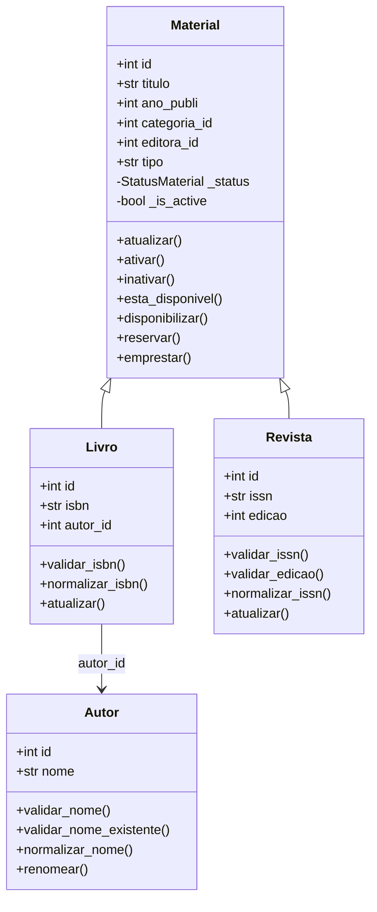

# Diagrama de Classes — Sistema APOLO

Este diagrama representa a herança entre as classes Material, Livro e Revista do sistema de gerenciamento de biblioteca APOLO.

## Descrição

A classe Material contém os atributos e métodos comuns aos materiais da biblioteca.

A classe Livro herda de Material e acrescenta os atributos ISBN e autor.

A classe Revista também herda de Material e acrescenta ISSN e edição.

A classe Autor representa os autores cadastrados no sistema, contendo os atributos id e nome, além de métodos de validação, normalização e alteração do nome.

A classe Livro possui o atributo autor_id, que referencia a classe Autor.

As classes Livro e Revista sobrescrevem o método atualizar(), utilizando super() para reaproveitar a implementação da classe Material.
  
