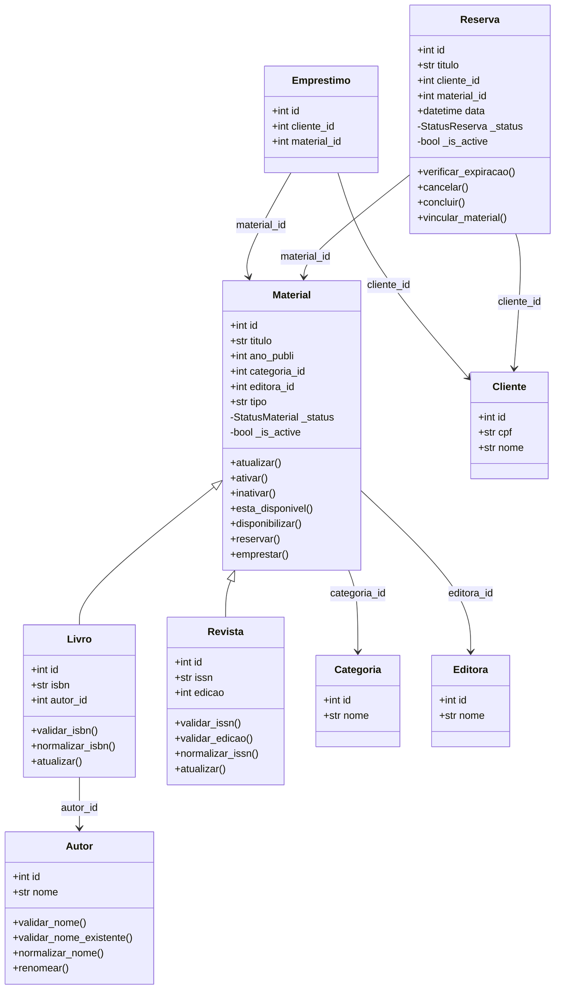
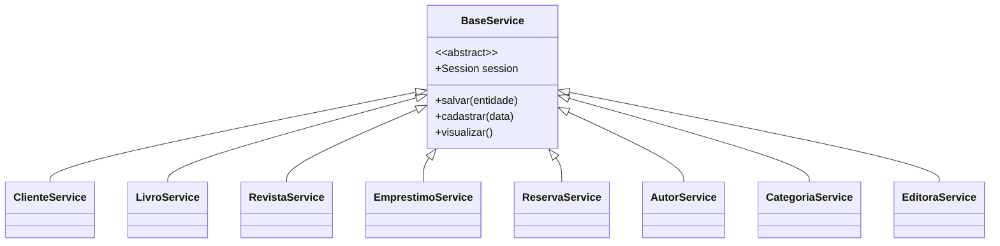

 
# Diagrama de Classes — Sistema APOLO

Este diagrama apresenta as principais entidades do sistema de gerenciamento de biblioteca APOLO, seus relacionamentos e a estrutura de serviços.

## 1. Diagrama das entidades

## 2. Diagrama dos serviços

## 3. Descrição dos relacionamentos

- **Material, Livro e Revista:** Livro e Revista herdam os atributos e métodos de Material.
- **Livro e Autor:** cada livro possui uma referência a um autor por meio de `autor_id`.
- **Material, Categoria e Editora:** os materiais possuem referências à categoria e à editora.
- **Empréstimo:** relaciona um cliente ao material emprestado.
- **Reserva:** relaciona um cliente ao material reservado, permitindo acompanhar o estado da reserva.
- **BaseService:** classe abstrata que centraliza operações compartilhadas, como salvar entidades, e define os métodos abstratos `cadastrar()` e `visualizar()`.
- **Services:** os serviços especializados herdam de BaseService e implementam as operações específicas de cada módulo.

## 4. Conclusão

A modelagem apresenta a estrutura principal do sistema APOLO, demonstrando herança, associações entre entidades e reutilização de código por meio da classe BaseService.
